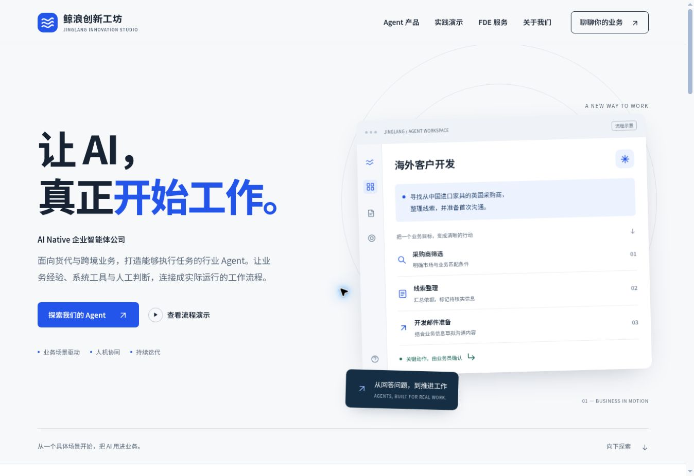

# 鲸浪创新工坊 · 公司官网

围绕「AI Native 企业智能体公司」定位的中文官网第一版。展示国际货代海外客户开发 Agent、可交互的示例工作流、Agent 业务落地服务（FDE）、团队介绍与需求沟通入口。新增中国物流 AI+OCR 智能制单方案交付案例，可从首页「AI 落地案例」进入。



[移动端布局预览](docs/preview-mobile.jpg)

## 本地开发

需要 Node.js 22 或更新版本，无第三方运行依赖，也无需安装依赖。

```bash
npm run dev
```

首次获取代码后，先初始化固定版本的设计技能：

```bash
git submodule update --init --recursive
```

打开终端显示的地址，默认 `http://localhost:5173`。支持 `PORT`、`HOST` 环境变量及 `--port`、`--host` 参数。

```bash
npm run check
npm run build
```

构建产物位于 `dist/`，可以部署到支持静态文件的托管服务。`dist/_headers` 提供适用于 Cloudflare Pages / Netlify 的响应头；其他平台需要在托管配置中设置等效响应头。GitHub Pages 不读取该文件。未配置固定站点域名，因此暂不生成 canonical、sitemap 或固定的分享地址。

## 内容与文件

| 文件 | 用途 |
| --- | --- |
| `public/index.html` | 页面内容、导航、产品定位与合作流程 |
| `public/styles.css` | 响应式设计、字体、颜色与交互状态 |
| `public/app.js` | 流程演示、键盘导航、需求提纲、复制与下载 |
| `public/site-config.js` | 商务邮箱、微信号、企业微信入口、主体与备案信息 |
| `public/cases/china-logistics-ai-ocr/` | 智能制单案例详情、截图步骤切换及原图查看 |
| `public/fonts/` | 自托管 Noto Sans SC 字体子集与 SIL OFL 许可 |
| `PRODUCT.md` | 产品定位、受众、事实边界与待补充资料 |
| `DESIGN.md` | 视觉方向、设计令牌与交互约定 |
| `.agents/skills/impeccable/` | 官方 Impeccable 设计技能，供后续 AI 协作使用 |

## 发布前需要补充

1. 商务邮箱、微信和公司主体已按用户提供信息配置。企业微信 HTTPS 链接与备案信息按实际情况补充。
2. 核实公开团队介绍和实际适用的备案信息。
3. 客户开发工作流仍为示例。智能制单案例为方案交付内容，保留原 PDF 的 7 张流程及系统截图；未公开含个人信息的单证。没有实际效果数据，设计指标不作为上线成效。
4. 确认产品当前实际能力、付费试点范围、服务响应安排，必要时更新文案。
5. 确定正式域名后补充 SEO URL、分享图片等信息。

本版需求表单只在浏览器内生成沟通提纲，支持复制和下载，不自动上传、不发送邮件、不存储线索。配置商务邮箱后，访客可主动打开自己的邮件客户端发送提纲。未包含后端、CRM、真实贸易数据查询或邮件自动发送服务。

## 字体

`public/fonts/jinglang-sans.ttf` 为 Noto Sans SC 可变字体的字形子集，保留现有页面与流程演示使用的字符及 ASCII。原字体来源：

https://github.com/google/fonts/tree/main/ofl/notosanssc

许可见 `public/fonts/OFL.txt`。新增文案时，若出现子集未包含的字符，浏览器会回退到中文系统字体；可以用 fonttools 重新生成子集。所有字体本地加载，没有第三方字体请求。

## Impeccable

按官方子模块方式安装，Codex 技能入口通过相对软链接指向 `vendor/impeccable/.agents/skills/impeccable`，来源为 `pbakaus/impeccable`，固定到提交 `4f956490f0056ae1ff5ea80372cf56e83c001d3c`（技能版本 4.8.0）。保留 Apache-2.0 许可与 NOTICE。技能不参与网站构建，也不会发布到 `dist/`。

在支持 Agent Skills 的 Codex 中可使用 `$impeccable`。此项目没有自动安装或信任设计检查 hook。可直接读取技能的排版、布局、响应式、无障碍与 polish 指南；引擎命令首次运行需要官方引擎或网络下载。本次环境中引擎未能运行，验证使用浏览器与项目自身检查，未声称通过其自动检测器。

## 当前验证范围

静态检查覆盖本地资源、锚点、唯一 ID、ARIA 引用、脚本 DOM 目标、示例声明及 JavaScript 语法。浏览器验证覆盖桌面页面、390px iframe 中的移动布局、移动导航、流程切换与键盘操作、需求整理及复制下载。iframe 验证不替代真实 iOS / Android 设备验收。

## 智能制单案例

详情路径：`/cases/china-logistics-ai-ocr/index.html`。首页导航以「AI 落地案例」下拉菜单提供总览与详情入口，首页精选案例区也可进入总览。总览页为 `public/cases/index.html`，新增案例时可在其中追加案例条目，并将详情链接加入导航。详情页可返回总览。六个流程步骤支持鼠标、方向键、Home/End；原图弹层支持上一张、下一张、左右键和 Escape，关闭后恢复焦点。所有界面图直接提取自用户原 PDF，图片来源和校验值见案例 `images/README.md`；原 PDF 和含个人信息的两张单证不进入仓库。

本次接入沿用现有设计，不重写 DESIGN.md；仍使用原固定版本的 Impeccable。设计引擎在当前环境不可运行，未将人工和浏览器验证表述为引擎检查通过。
